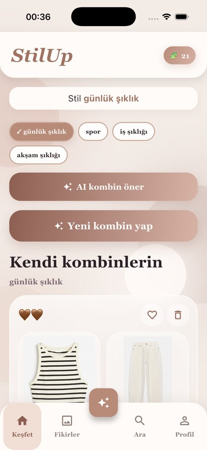
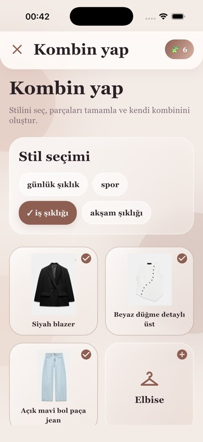
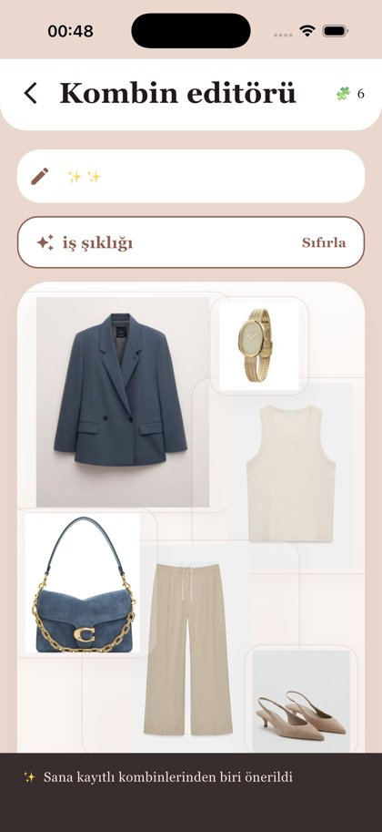
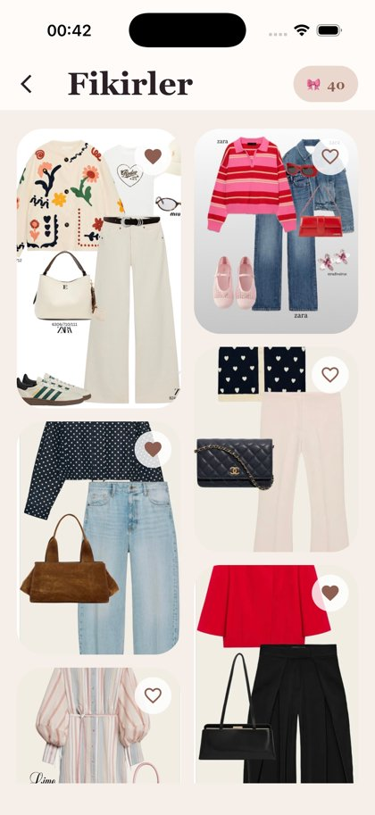
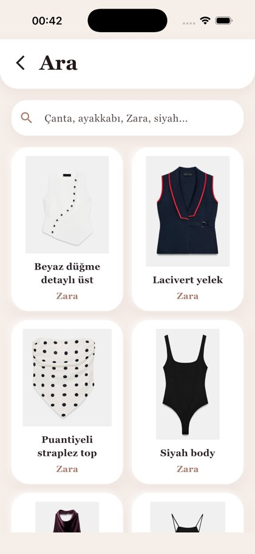
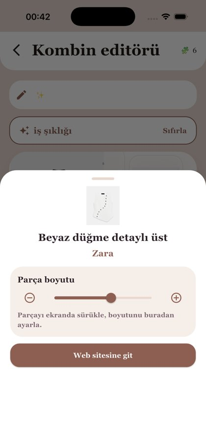
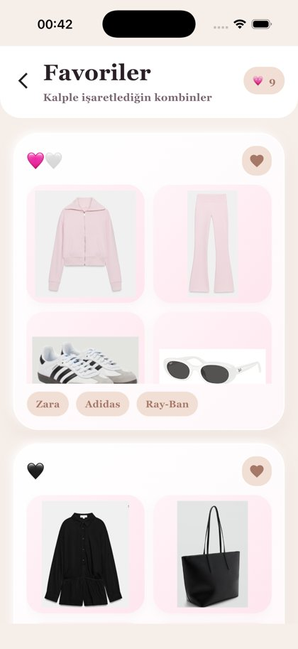
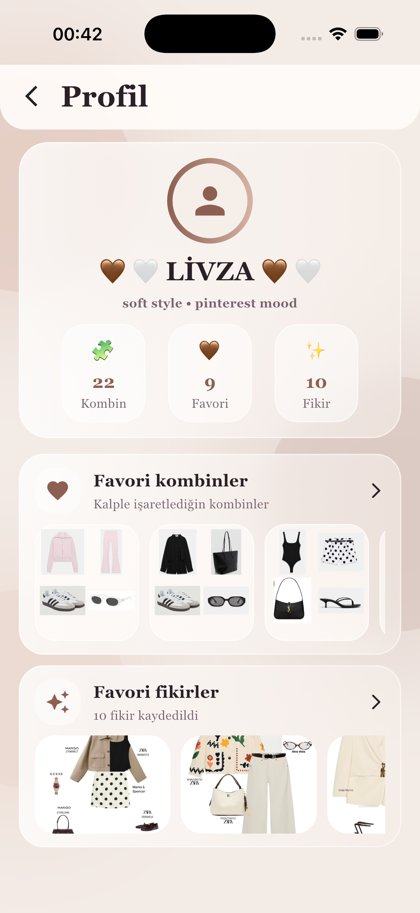
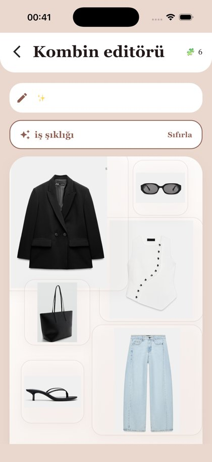

# StilUp — Kombin Oluşturma Mobil Uygulaması

StilUp, kullanıcıların seçtikleri stile göre (günlük şıklık, spor, iş şıklığı, akşam şıklığı) kombin oluşturup kaydedebildiği bir Flutter mobil uygulamasıdır. Kullanıcı ürünleri kategorilere göre seçer, kombin editöründe parçaları sürükleyip yerleştirir, kombinlerini kaydeder ve ilham galerisinden fikir alır.

## Ekran Görüntüleri

| Ana Sayfa | Kombin Oluşturma | Kombin Editörü |
|:---:|:---:|:---:|
|  |  |  |

| Fikirler | Ürün Arama | Ürün Detayı |
|:---:|:---:|:---:|
|  |  |  |

| Favoriler | Profil | Kombin Seçimi |
|:---:|:---:|:---:|
|  |  |  |

## Özellikler

- **Stile göre kombin:** Günlük, spor, iş ve akşam şıklığı kategorileri
- **Kombin editörü:** Parçaları sürükle-bırak ile serbestçe yerleştirme
- **Kombin önerisi:** Seçilen stile göre kayıtlı kombinlerden öneri
- **Ürün arama ve detay:** Ürünleri arama, detayını görüntüleme ve mağaza sayfasına yönlendirme
- **Fikirler (ilham) galerisi:** Pinterest tarzı ızgara görünümü ve tam ekran görüntüleme
- **Favoriler:** Kombinleri ve ilham görsellerini favorilere ekleme
- **Kalıcı kayıt:** Kombinler ve favoriler cihazda saklanır
- **Profil ekranı:** Kayıtlı kombin sayısı ve son kombin özeti

## Kullanılan Teknolojiler

- **Flutter** ve **Dart**
- **shared_preferences** — kombin ve favorilerin JSON olarak cihazda saklanması
- **url_launcher** — ürünlerin mağaza sayfalarının açılması
- **flutter_staggered_grid_view** — ilham galerisi ızgara düzeni

## Proje Yapısı

```
lib/
├── main.dart          # Uygulama girişi ve açılış (splash) ekranı
├── data/              # Ürün verileri, önerilen kombinler, kayıt yönetimi
├── screens/           # Ana sayfa, kombin oluşturma, editör, arama, profil vb.
└── widgets/           # Alt menü, kombin kartı, seçim çipleri gibi ortak bileşenler
```

## Çalıştırma

```bash
flutter pub get
flutter run
```

## Not

Uygulamadaki ürün görselleri ve mağaza bağlantıları yalnızca eğitim amaçlı, örnek veri olarak kullanılmıştır.

---

Geliştiren: **Livza Balkan** — Mudanya Üniversitesi, Bilgisayar Mühendisliği
